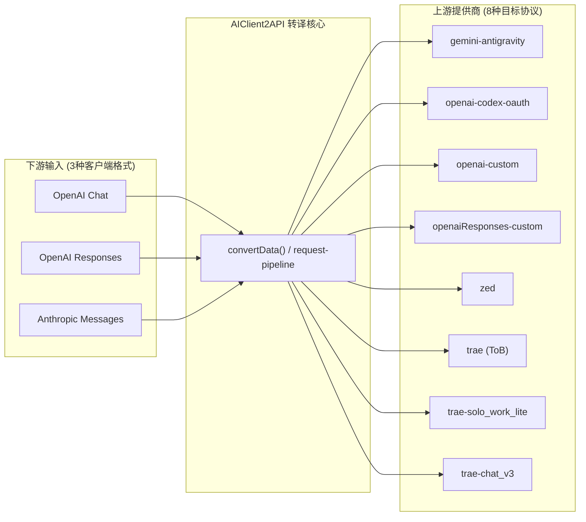
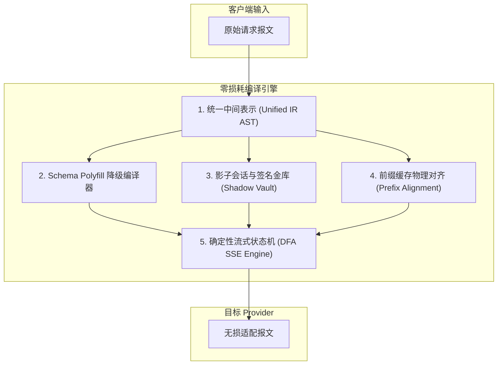
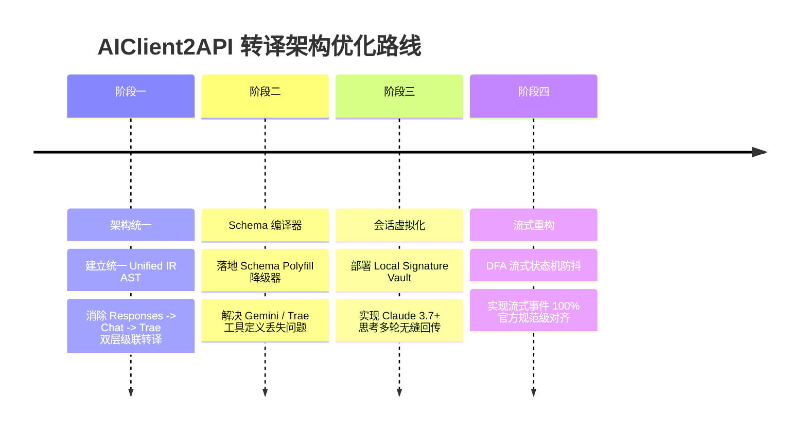

# AIClient2API 跨协议转译评估与理论优化全景指南

> **版本**：v1.6.0  
> **更新时间**：2026-10-16  
> **修订说明**：v1.6.0 完成 Phase 4 可选增强实施落地（跨协议合并去重、工具稳定排序与缓存日志化，见第八节修订记录）  
> **适用范围**：AIClient2API 网关核心转译管道、协议适配器及周边客户端工具

---

## 目录

- [一、背景与架构总览](#一背景与架构总览)
- [二、转译损耗理论模型与评估维度](#二转译损耗理论模型与评估维度)
  - [2.1 损耗等级定义 (Tiers)](#21-损耗等级定义-tiers)
  - [2.2 评估的 7 大核心维度](#22-评估的-7-大核心维度)
  - [2.3 协议无关的管道护栏层](#23-协议无关的管道护栏层pipeline-guardrails)
- [三、24 种协议组合全景评估矩阵](#三24-种协议组合全景评估矩阵)
- [四、24 种组合深度剖析与现状评估](#四24-种组合深度剖析与现状评估)
  - [4.1 下游为 OpenAI Chat Completion (8 种)](#41-下游为-openai-chat-completion-8-种)
  - [4.2 下游为 OpenAI Responses (8 种)](#42-下游为-openai-responses-8-种)
  - [4.3 下游为 Anthropic Messages (8 种)](#43-下游为-anthropic-messages-8-种)
- [五、理论优化体系：构建零损耗网关转译架构](#五理论优化体系构建零损耗网关转译架构)
  - [5.1 统一中间表示层 (Unified IR AST)](#51-统一中间表示层-unified-ir-ast)
  - [5.2 工具 Schema Polyfill 降级编译器](#52-工具-schema-polyfill-降级编译器)
  - [5.3 影子会话虚拟化与签名金库 (Shadow Session & Signature Vault)](#53-影子会话虚拟化与签名金库-shadow-session--signature-vault)
  - [5.4 前缀缓存物理对齐与思考预算平滑插值](#54-前缀缓存物理对齐与思考预算平滑插值)
  - [5.5 确定性流式有限状态机 (DFA SSE Engine)](#55-确定性流式有限状态机-dfa-sse-engine)
- [六、不可逾越的物理天花板（硬约束限制）](#六不可逾越的物理天花板硬约束限制)
- [七、优化演进路线与最佳实践指引](#七优化演进路线与最佳实践指引)
- [八、修订记录](#八修订记录)

---

## 一、背景与架构总览

AIClient2API 作为统一大模型客户端聚合与转译网关，核心职责是抹平异构客户端与异构大模型上游之间的通信协议壁垒。当前系统中：

- **下游提供 3 种主流客户端开放接口**：
  1. `OpenAI Chat Completion` (`POST /v1/chat/completions`)
  2. `OpenAI Responses` (`POST /v1/responses`)
  3. `Anthropic Messages` (`POST /v1/messages`)
- **上游配置了 8 种实际提供商节点 (Provider Pools)**：
  1. `gemini-antigravity`：Google CloudCode 内部 RPC / Gemini contents
  2. `openai-codex-oauth`：ChatGPT Backend Codex Responses API 规范
  3. `openai-custom`：标准 OpenAI Chat Completions 协议
  4. `openaiResponses-custom`：标准 OpenAI Responses API 规范
  5. `zed`：Zed Cloud RPC（内嵌 Anthropic Messages 规范）
  6. `trae` (ToB)：字节跳动 Trae IDE 内部私有 RPC (`function: "chat"`)
  7. `trae-solo_work_lite`：字节跳动 Trae SOLO Agent v3 私有协议 (`function: "solo_work_lite"`)
  8. `trae-chat_v3`：字节跳动 Trae Chat v3 私有协议 (`function: "chat_v3"`)

二者笛卡尔积构成了 **3 × 8 = 24 种双向转译场景**。

> **覆盖范围说明（v1.1.0 补充）**：本矩阵为**主流组合子集**。网关在下游同时暴露 Gemini 原生端点（`POST /v1beta/models/{model}:generateContent`），上游另配置有 `claude-custom`、`claude-kiro-oauth`、`grok-web`、`grok-cli-oauth`、`atlascloud`、`qiniu`、`fenno` 等节点，完整组合空间大于 3 × 8；本文聚焦使用量最高的 24 种组合，其余组合可参照同协议家族类推。



---

## 二、转译损耗理论模型与评估维度

跨协议转译中的“损耗”远不止纯文本截断，而是涵盖信息结构完整性、协议执行语义和流式状态机的综合衰减。本文将转译损耗量化为 4 个等级，并在 7 个核心维度进行评估。

### 2.1 损耗等级定义 (Tiers)

- **Tier 0 (无损 / 原生直通)**：
  协议 100% 同构，请求体透传或仅做地址级转发，流式事件 1:1 透传，元数据完整保留。
- **Tier 1 (极微损 / 同源高保真)**：
  处于同一协议家族或超轻量包装，核心语义、流式数据、工具调用及思考内容完全保留，仅在非核心参数（如默认工具注入、非流式本地合流）存在细微实现差异。
- **Tier 2 (中度损失 / 语义平移)**：
  跨异构协议产生语义结构折叠，如多轮角色合并、System 提示词位置移动、显式 Prompt Caching 标记丢失、Thinking 预算离散量化等。
- **Tier 3 (高损 / 特性降级)**：
  协议级硬特性不兼容，如加密签名丢失导致无法多轮回传、复杂的 JSON Schema 被大幅清洗导致工具解析故障、多级链式转译产生错误累加。

### 2.2 评估的 7 大核心维度

1. **System Prompt / Instructions 架构**：
   OpenAI 允许在消息流任意位置插入多个 `system` 消息；Anthropic 与 Responses 则要求顶层单条或固定结构。
2. **多轮对话结构与角色交替 (Role Alternation)**：
   OpenAI 允许连续同角色消息；Gemini 与 Anthropic 强制严格交替（`user ↔ model` / `user ↔ assistant`）。
3. **深度思考 (Thinking / Reasoning / CoT)**：
   Anthropic 的精确 Token 预算（`budget_tokens`）与 HMAC 加密签名；OpenAI/Trae 的离散等级（`low/medium/high`）；Gemini 的 `thinkingLevel`。
4. **工具调用 (Tool / Function Calling) 与 JSON Schema 兼容性**：
   标准 JSON Schema 的高级关键字（`patternProperties`, `$ref`, `oneOf`）能否被 Gemini Protobuf 解析器或 Trae 字符串化解析器正确消费。
5. **显式提示词缓存 (Prompt Caching)**：
   Anthropic 显式 `cache_control: { type: "ephemeral" }` 与 OpenAI/Gemini 隐式前缀缓存（Prefix Caching）之间的语义鸿沟。
6. **多模态数据表达 (Multimodal)**：
   OpenAI 的 `image_url`、Anthropic 的原生 Base64 与 `document` (PDF) 块、Gemini 的 `inlineData` 之间的转换支持度。
7. **流式状态机 (SSE Event Stream FSM)**：
   OpenAI 粗粒度增量块（`delta.content`）与 Anthropic 细粒度生命周期事件（`content_block_start` 等）之间的逆向合成精度。

### 2.3 协议无关的管道护栏层（Pipeline Guardrails）

在上述跨协议转换器之外，网关在 `src/handlers/request-pipeline.js` 中还部署了一套协议无关的统一运行时护栏，用于拦截和修正上游模型的各类边界异常：

1. **首内容前缓冲与空响应重试（Pre-content Buffering & Empty Retry）**：
   - **痛点**：深度推理模型（典型如 Antigravity 的 Gemini 3 思考模型）偶发在长思考后直接以 `MALFORMED_FUNCTION_CALL` 或空内容 `STOP` 收尾，整条流仅产出 thinking 而没有任何正文或工具调用。旧逻辑若直接下发 thinking，客户端会判定为流已开始而无法无损重试。
   - **机制**：由 `nativePayloadHasMeaningfulContent()` 判定文本、工具调用或内联数据等“有效内容”。在首个有效内容到达前暂缓向客户端下发，若上游空转结束则自动丢弃思考缓冲，并通过 `resolveEmptyUpstreamResponseRetry` 使用独立小额预算（默认 5 次，与凭证切换预算隔离）静默重试或轮换凭证，在预算内杜绝下游接收到只有思考过程的空白回复；空转节点不会被误标记为健康。
   - **例外**：OpenAI 协议上游的 `reasoning_content` / `reasoning` 思考增量被**有意归类为有效内容直接放行**——深度推理模型长时间思考时，滞留思考帧会触发下游看门狗超时断开，故 OpenAI 系思考帧实时透传、不进入缓冲（Gemini / Claude / Responses 协议的思考帧仍适用缓冲）。
2. **Finish Reason 工具调用修正**：
   - 当上游已产出工具调用却以普通结束原因收尾时（`hasToolCall && needsConversion`），将结束原因改写为下游预期的工具调用枚举：OpenAI `stop → tool_calls`、Anthropic `end_turn → tool_use`、Gemini `STOP → TOOL_CALLS`；同构直通（Tier 0）场景不改写。
   - 注：`stop ↔ end_turn`、`length ↔ max_tokens` 等通用枚举映射属于逐协议转换层职责（`utils/protocol-utils.js` 的 `mapFinishReason()`），不在本护栏层。
3. **结束帧幂等与去重（Idempotent Stream Termination）**：
   - 流式处理中通过 `hasMessageStop` 状态位跟踪生命周期：OpenAI 客户端按规范**无条件补写一次** `[DONE]`；Anthropic（`message_stop`）、Responses（`response.completed`）、Gemini（`finishReason: STOP`）仅在上游未发送过终止事件时兜底合成。配合 `!responseClosed && !clientDisconnected && !isRetry` 防重入与 `writableEnded` 检查，杜绝重试递归、异常捕获或连接复用时向客户端重复写入结束标记抛出 `"write after end"` 错误。

---

## 三、24 种协议组合全景评估矩阵

| 序号 | 下游客户端格式 | 上游目标 Provider | 实际转换链路 | 当前现状评级 | 理论优化后评级 | 当前核心损失与现状特征 |
| :---: | :--- | :--- | :--- | :---: | :---: | :--- |
| **01** | OpenAI Chat | `openai-custom` | OpenAI ➔ OpenAI | **Tier 0** | **Tier 0** | 原生 1:1 直通，零损耗。 |
| **02** | OpenAI Chat | `openaiResponses-custom` | OpenAI ➔ Responses | **Tier 2** | **Tier 1** | 多 system 消息被拼为顶层 instructions；事件流逆向组装。 |
| **03** | OpenAI Chat | `openai-codex-oauth` | OpenAI ➔ Codex | **Tier 1** | **Tier 1** | 结构转为 Responses；删除清单剔除私有字段并按条件注入内置工具；本地消费流合流。 |
| **04** | OpenAI Chat | `gemini-antigravity` | OpenAI ➔ Gemini ➔ CloudCode | **Tier 1~2** | **Tier 1** | 连续同角色 parts 级合并；Schema Polyfill（$ref 展开/约束自然语言化注入/oneOf 降级）+ 7 键白名单清洗；思考按模型代际双轨映射。 |
| **05** | OpenAI Chat | `zed` | OpenAI ➔ Claude ➔ Zed RPC | **Tier 2** | **Tier 1** | 经由 Claude 格式再入 Zed 信封；连续同角色合并。 |
| **06** | OpenAI Chat | `trae` (ToB) | OpenAI ➔ Trae Raw Chat | **Tier 1** | **Tier 1** | 同源协议轻度包装；`parameters` 转 JSON 字符串；强制 SSE。 |
| **07** | OpenAI Chat | `trae-solo_work_lite` | OpenAI ➔ Trae SOLO | **Tier 1** | **Tier 1** | 同源协议轻度包装；个人 SOLO 专属 function 路由。 |
| **08** | OpenAI Chat | `trae-chat_v3` | OpenAI ➔ Trae Chat v3 | **Tier 1** | **Tier 1** | 同源协议轻度包装；Chat v3 专属 function 路由。 |
| **09** | OpenAI Responses | `openai-custom` | Responses ➔ OpenAI | **Tier 1~2** | **Tier 1** | `input` 结构解包为 messages，已保留 reasoning item（折入 assistant 消息）；item_reference 显式跳过并打日志；流式合流。 |
| **10** | OpenAI Responses | `openaiResponses-custom` | Responses ➔ Responses | **Tier 0** | **Tier 0** | 原生 1:1 直通，规范完全对齐。 |
| **11** | OpenAI Responses | `openai-codex-oauth` | Responses ➔ Codex | **Tier 1** | **Tier 1** | 同源高保真；底层皆为 Responses 协议；仅剔除私有拒收字段（删除清单制）并强制注入 reasoning/store 等配置。 |
| **12** | OpenAI Responses | `gemini-antigravity` | Responses ➔ Gemini ➔ CloudCode | **Tier 2** | **Tier 1~2** | 非消息 item 降级；Schema Polyfill + 深度清洗；已恢复 reasoning.effort 到 Gemini 双轨 thinking 映射；生命周期事件映射重。 |
| **13** | OpenAI Responses | `zed` | Responses ➔ Claude ➔ Zed RPC | **Tier 2** | **Tier 1** | 双层转换；`input` 转 Claude `messages`；思考参数由 effort 按固定表换算 budget（1024~32000 五档）。 |
| **14** | OpenAI Responses | `trae` (ToB) | Responses ➔ Chat ➔ Trae | **Tier 2** | **Tier 1** | 双层转译瓶颈；`input` 折叠为 messages 再包装为 Trae 结构。 |
| **15** | OpenAI Responses | `trae-solo_work_lite` | Responses ➔ Chat ➔ Trae | **Tier 2** | **Tier 1** | 同上，双层转译瓶颈，面向 SOLO Agent。 |
| **16** | OpenAI Responses | `trae-chat_v3` | Responses ➔ Chat ➔ Trae | **Tier 2** | **Tier 1** | 同上，双层转译瓶颈，面向 Chat v3。 |
| **17** | Anthropic Messages | `openai-custom` | Claude ➔ OpenAI | **Tier 1** | **Tier 1** | **Prompt Caching 显式标记丢失**；已修复思考预算换算阈值与签名金库虚拟签名注入/剥离闭环。 |
| **18** | Anthropic Messages | `openaiResponses-custom` | Claude ➔ Responses | **Tier 1** | **Tier 1** | `system` 转 `instructions`；已统一规范五档预算换算与签名金库虚拟签名闭环。 |
| **19** | Anthropic Messages | `openai-codex-oauth` | Claude ➔ Codex | **Tier 1** | **Tier 1** | 缓存控制丢失；预算映射统一与签名金库虚拟签名闭环；document 块占位并支持 CODEX_PDF_AS_INPUT_FILE 尝鲜。 |
| **20** | Anthropic Messages | `gemini-antigravity` | Claude ➔ Gemini ➔ CloudCode | **Tier 1~2** | **Tier 1~2** | 思考签名双向闭环已加固（支持 <50 字符短签名与流式 signature_delta 转发）；document 块原生 inlineData 无损适配（>20MB 兜底）；Schema Polyfill 降级编译器落地。 |
| **21** | Anthropic Messages | `zed` | Claude ➔ Claude (Zed RPC) | **Tier 0~1** | **Tier 0** | **原生级高保真**。跳过协议转换器；zed-core 仍改写 max_tokens/system/tools/thinking 配置。 |
| **22** | Anthropic Messages | `trae` (ToB) | Claude ➔ OpenAI ➔ Trae | **Tier 2~3** | **Tier 1~2** | 双层跨协议转译；缓存丢失；复杂工具 Schema 经两次处理易失真。 |
| **23** | Anthropic Messages | `trae-solo_work_lite` | Claude ➔ OpenAI ➔ Trae | **Tier 2~3** | **Tier 1~2** | 同上，双层跨协议转译，思考特征降级为 Trae 3 档深度。 |
| **24** | Anthropic Messages | `trae-chat_v3` | Claude ➔ OpenAI ➔ Trae | **Tier 2~3** | **Tier 1~2** | 同上，双层跨协议转译。 |

---

## 四、24 种组合深度剖析与现状评估

### 4.1 下游为 OpenAI Chat Completion (8 种)

#### 01. OpenAI Chat ➔ `openai-custom`
- **协议链路**：`OpenAI Chat ➔ OpenAI Chat`
- **当前损失**：**Tier 0 (无损)**
- **详细评估**：
  - 双方属于同构协议。在 `request-pipeline.js` 中匹配 `getProtocolPrefix('openai') === getProtocolPrefix('openai-custom')`，完全跳过转换器。
  - 请求体中的 `messages`、`tools`、`temperature`、`reasoning_effort` 原样直接送入 `axiosInstance.request`。
  - 上游 SSE 流式块 `data: {...}` 逐字节直通，零延迟、零精度损耗。

#### 02. OpenAI Chat ➔ `openaiResponses-custom`
- **协议链路**：`OpenAI Chat ➔ OpenAI Responses`
- **当前损失**：**Tier 2 (中度损失)**
- **详细评估**：
  - **结构重组**：由 `OpenAIConverter.toOpenAIResponsesRequest` 转换。`messages` 列表被解析转换为 `input` 数组。
  - **System 消息折叠**：若对话流中穿插有中间轮次的 `system` 消息，会被全部提取并用换行符拼接为顶层单个 `instructions` 字符串，丢失了系统提示在多轮中的局部作用域边界。
  - **流式合成**：上游返回 Responses API 的细粒度事件（如 `response.output_text.delta`），网关需要将其逆向组装为 OpenAI Chat 的 `choices[0].delta` 结构，微小增加了 CPU 序列化开销。

#### 03. OpenAI Chat ➔ `openai-codex-oauth`
- **协议链路**：`OpenAI Chat ➔ Codex Responses API`
- **当前损失**：**Tier 1 (极微损)**
- **详细评估**：
  - **结构映射**：转为 Responses 结构，`messages` 映射为 `input`。
  - **条件注入与删除清单**：`codex-core.js` 采用「展开原 body + 删除清单 + 强制注入」策略：
    - 删除 `previous_response_id`、`metadata`、`prompt_cache_retention`、`safety_identifier`、`stream_options`；
    - 强制 `store: false`、`include: ['reasoning.encrypted_content']`、`parallel_tool_calls: true`（无工具时移除）、追加 `reasoning: { effort, summary }`；
    - 工具注入带条件：常规模型缺省补 `web_search` 与 `image_generation`（`spark` 系模型不补后者）；`gpt-image-2` 图像模型则整体替换 tools 为 `image_generation`。
  - **强制流式机制**：Codex 官方上游只开放流式端点，非流式请求也是在本地将 SSE 流消费并合并后返回，可能带来微小的内存缓冲开销，但对结果内容无损。

#### 04. OpenAI Chat ➔ `gemini-antigravity`
- **协议链路**：`OpenAI Chat ➔ Gemini generateContent ➔ CloudCode RPC`
- **当前损失**：**Tier 2 (中度损失)**
- **详细评估**：
  - **严格交替合并**：Gemini 强制要求 `contents` 中 `user` 和 `model` 严格交替。OpenAI 允许的连续 `user` 提问会被内联合并逻辑（存在于 `OpenAIConverter` / `ClaudeConverter` / `OpenAIResponsesConverter` 三处 `toGeminiRequest` 中，无独立 `mergeConsecutiveMessages` 函数）在 **parts 数组级**合并为一个 content——各段文本仍保留为独立 part，并非文本拼接，单轮语义界限弱化但未完全湮灭。
  - **Schema 强剪切**：Gemini Protobuf 无法反序列化复杂 JSON Schema，`cleanJsonSchemaProperties`（`converters/utils.js`）按 **7 键白名单**（`type` / `description` / `properties` / `required` / `enum` / `items` / `nullable`）清洗，`patternProperties`、`default`、`oneOf`、`$ref`、`pattern`、`format`、数值/长度边界等全部被剥离，导致工具定义的边界约束丢失。
  - **思考配置统一映射**：`reasoning_effort`（none/low/medium/high/xhigh）统一映射为 Gemini 3+ 的 `thinkingConfig.thinkingLevel: LOW/MEDIUM/HIGH`（`none` 则不下发 thinkingConfig；`max/xhigh` 收敛为 HIGH；`minimal` 收敛为 LOW）。不再维护 Gemini 2.5 的 `thinkingBudget` 分支。

#### 05. OpenAI Chat ➔ `zed`
- **协议链路**：`OpenAI Chat ➔ Claude Messages ➔ Zed Cloud RPC`
- **当前损失**：**Tier 2 (中度损失)**
- **详细评估**：
  - 经历了两阶段处理：先转为 Claude Messages 格式，再进入 `zed-core.js` 包装入 Zed RPC 信封（`thread_id`, `prompt_id`, `provider: 'anthropic'`）。
  - OpenAI 消息中的连续同角色消息同样被强制拼接；System 提示词提取为 top-level `system`。
  - Zed 强制 SSE 传输，下游若是非流式请求需服务端流式收集后合流。

#### 06. OpenAI Chat ➔ `trae` (ToB)
- **协议链路**：`OpenAI Chat ➔ Trae Enterprise raw_chat`
- **当前损失**：**Tier 1 (极微损)**
- **详细评估**：
  - 协议同属于 `openai` 家族，`getProtocolPrefix` 相同，不经过全局转换器。
  - `trae-core.js` 的 `prepareRequestBody` 进行目标封装：
    - 将 `tools[].function.parameters` 对象二次序列化为 JSON 字符串（上游 Go 结构体强制要求）。
    - 将标量 `messages[].content` 统一包装为 `[{ type: "text", text: "..." }]`；数组型 content 逐 part 规范化，图片等非文本 part 原样透传。
    - 注入企业鉴权参数：`conversation_id`、`session_id`、`access_type: 4`、`function: "chat"`（注：这些会话参数**仅 ToB 分支注入**，见 07/08 差异说明）。
  - 语义完整度极高，代码场景工具调用与文本输出几乎原生保真。

#### 07. OpenAI Chat ➔ `trae-solo_work_lite`
- **协议链路**：`OpenAI Chat ➔ Trae SOLO Agent`
- **当前损失**：**Tier 1 (极微损)**
- **详细评估**：
  - 核心转换机制与 06 相同，差异在于：针对个人版 SOLO Agent 通道，负载标记 `function: "solo_work_lite"`，且**不注入** `conversation_id` / `session_id` / `access_type`（个人版分支仅设置 `max_mode` 与 `function`），上游直接接入个人版智能体调度引擎。

#### 08. OpenAI Chat ➔ `trae-chat_v3`
- **协议链路**：`OpenAI Chat ➔ Trae Chat v3`
- **当前损失**：**Tier 1 (极微损)**
- **详细评估**：
  - 机制与 07 一致（个人版分支，不注入企业会话参数），负载标记 `function: "chat_v3"`，面向 Trae 个人版通用对话通道。

---

### 4.2 下游为 OpenAI Responses (8 种)

#### 09. OpenAI Responses ➔ `openai-custom`
- **协议链路**：`OpenAI Responses ➔ OpenAI Chat`
- **当前损失**：**Tier 2 (中度损失)**
- **详细评估**：
  - **降级折叠**：由 `OpenAIResponsesConverter.toOpenAIRequest` 执行。Responses 协议的富状态 `input` 数组被解构并强行展平为普通的 `messages`（`function_call` ➔ 并入 assistant `tool_calls`、`function_call_output` ➔ `role: 'tool'` 消息）；**`reasoning` 思考项与 `item_reference` 引用项在 switch 中无对应分支，被静默丢弃**。
  - **Instructions 降级**：顶层 `instructions` 被降级插入为 messages 数组开头的 `{ role: 'system', content: instructions }`。
  - **流式反向模拟**：上游普通的 Chat `delta` 分块需经由 `streamStateManager` 模拟生成 Responses API 的生命周期事件（`response.created` ➔ `response.output_item.added` ➔ `response.completed`），状态跟踪粒度弱于原生 Responses 服务。

#### 10. OpenAI Responses ➔ `openaiResponses-custom`
- **协议链路**：`OpenAI Responses ➔ OpenAI Responses`
- **当前损失**：**Tier 0 (无损)**
- **详细评估**：
  - 双端协议完全对齐，原生直通。请求参数原样传递，上游原生 Responses SSE 流逐事件转发。

#### 11. OpenAI Responses ➔ `openai-codex-oauth`
- **协议链路**：`OpenAI Responses ➔ Codex Responses API`
- **当前损失**：**Tier 1 (极微损 / 同源高保真)**
- **详细评估**：
  - Codex 底层原本就是基于 Responses API 规范设计。
  - 字段映射高度对齐：`input`、`instructions`、`tools`、`reasoning` 均原生对应。
  - 仅需处理 Codex 节点的特殊白名单过滤（清理掉不支持透传的私有元数据字段），保真度极高。

#### 12. OpenAI Responses ➔ `gemini-antigravity`
- **协议链路**：`OpenAI Responses ➔ Gemini contents ➔ CloudCode RPC`
- **当前损失**：**Tier 2~3 (中高损失)**
- **详细评估**：
  - `input` 复杂多类型项向 Gemini `contents` 的映射存在阻抗失配；Gemini 强制要求交替角色，Responses 中如果出现多个连续用户输入 item 会在 parts 级被强制合并。
  - JSON Schema 同样按 7 键白名单被剥离高级约束属性。
  - **`reasoning.effort` 在该方向完全未映射**（`OpenAIResponsesConverter.toGeminiRequest` 不读取该字段），思考配置静默丢失——这是本组合区别于组合 04 的额外损耗点。
  - 流式反向转换重度依赖状态机将 Gemini 的响应流拼装成 Responses 的结构化事件。

#### 13. OpenAI Responses ➔ `zed`
- **协议链路**：`OpenAI Responses ➔ Claude Messages ➔ Zed RPC`
- **当前损失**：**Tier 2 (中度损失)**
- **详细评估**：
  - Responses 的 `input` 转换为 Claude 的 `messages`；`instructions` 转为 Claude `system`。
  - 思考配置由 `reasoning.effort` 按固定表换算为 Claude 的 `budget_tokens`（minimal→1024 / low→2048 / medium→8192 / high→20000 / xhigh·max→32000）；zed-core 对自适应模型还会将 budget 反解回 effort 档位，存在二次量化。
  - 流式经由 Zed 的 Claude SSE（`content_block_delta`）二次解码，再编码为 Responses SSE 事件。

#### 14. OpenAI Responses ➔ `trae` (ToB)
- **协议链路**：`OpenAI Responses ➔ OpenAI Chat ➔ Trae RPC`
- **当前损失**：**Tier 2 (中度损失)**
- **详细评估**：
  - **双重级联转译瓶颈**：先通过 `OpenAIResponsesConverter` 降级为 OpenAI Chat，再由 `TraeApiService` 包装为 Trae 专有格式。
  - 经历了 Responses ➔ Chat 的展平损失，再加上 Chat ➔ Trae 的参数序列化过程。

#### 15. OpenAI Responses ➔ `trae-solo_work_lite`
- **协议链路**：`OpenAI Responses ➔ OpenAI Chat ➔ Trae SOLO`
- **当前损失**：**Tier 2 (中度损失)**
- **详细评估**：与 14 相同，双级转译。面向 SOLO 通道。

#### 16. OpenAI Responses ➔ `trae-chat_v3`
- **协议链路**：`OpenAI Responses ➔ OpenAI Chat ➔ Trae Chat v3`
- **当前损失**：**Tier 2 (中度损失)**
- **详细评估**：与 14、15 相同，双级转译。面向 Chat v3 通道。

---

### 4.3 下游为 Anthropic Messages (8 种)

#### 17. Anthropic Messages ➔ `openai-custom`
- **协议链路**：`Anthropic Messages ➔ OpenAI Chat`
- **当前损失**：**Tier 2 (中度损失)**
- **详细评估**：
  - **Prompt Caching 显式标记彻底失效**：Claude 客户端打在 system/user/tools 上的 `cache_control: { "type": "ephemeral" }` 在 OpenAI 协议中无对应字段，直接被剥除丢弃。
  - **思考加密签名丢弃**：Claude 3.7+ 输出包含加密的 `signature`，该字段在 OpenAI 协议中无处存放，回传时丢失（思考文本本身映射为 `reasoning_content` 保留）。
  - **思考预算离散化**：Anthropic 的精确数字 `budget_tokens` 按阈值量化（`≤50 → low`、`≤200 → medium`、`>200 → high`）降级为 OpenAI 的 `reasoning_effort`。由于常规预算均大于 200，实际几乎全部坍缩为 `high`，`medium` 档名存实亡（如 `budget_tokens: 3072` 映射结果为 `high` 而非直觉上的 `medium`）。
  - **流式模拟**：OpenAI 的 `delta` 数据必须通过 `AnthropicSseEmitter` 模拟生成复杂的 `message_start`、`content_block_start`、`content_block_delta`、`content_block_stop`、`message_delta`、`message_stop` 事件链。
  - **缓存统计回填（已有的局部补偿）**：响应方向上 `prompt_tokens_details.cached_tokens` 会被回填为 Claude 的 `usage.cache_read_input_tokens`——缓存**计量**无损，丢失的仅是客户端**显式标记**缓存位置的能力。

#### 18. Anthropic Messages ➔ `openaiResponses-custom`
- **协议链路**：`Anthropic Messages ➔ OpenAI Responses`
- **当前损失**：**Tier 2 (中度损失)**
- **详细评估**：
  - Claude 的 `system` 映射到 `instructions`，`messages` 映射到 `input`。
  - 同样存在 Prompt Caching 显式标记丢失和思考签名无法妥善保存的问题。

#### 19. Anthropic Messages ➔ `openai-codex-oauth`
- **协议链路**：`Anthropic Messages ➔ Codex Responses API`
- **当前损失**：**Tier 2 (中度损失)**
- **详细评估**：
  - 核心机制与 18 类似。
  - Codex 注入的系统工具和预置 Agent 逻辑可能对 Claude Code 等专用 CLI 客户端的自主决策造成微小扰动。

#### 20. Anthropic Messages ➔ `gemini-antigravity`
- **协议链路**：`Anthropic Messages ➔ Gemini contents ➔ CloudCode RPC`
- **当前损失**：**Tier 2~3 (中高损失，视工具复杂度而定)**
- **详细评估**：
  - **思考签名经 `thoughtSignature` 闭环回传（v1.1.0 修正）**：Claude thinking block 的 `signature` 被 `ClaudeConverter` 映射为 Gemini 原生 `thoughtSignature` 字段随请求上送，回程再由 `GeminiConverter` 还原为 Claude `signature`（流式以 `signature_delta` 下发），多轮工具调用的签名链基本保持完整。残余风险：长度 **<50 字符的签名被静默丢弃**；`redacted_thinking` 降级为纯文本占位符 `[Redacted Thinking: ...]`。
  - **工具 Schema 严重损伤**：Claude CLI / Code 经常携带深度嵌套的 JSON Schema（如含 `oneOf` 联合类型、`pattern` 正则约束），经 `cleanJsonSchemaProperties` 按 7 键白名单强力清洗后，Gemini 容易生成格式错误的工具调用入参——**这是本组合当前最主要的现实风险**。
  - **文档块静默丢弃**：Claude 特有的 `type: 'document'` 原生 PDF 块在 Claude ➔ Gemini 转换的 block switch 中**没有对应分支**，整块被静默丢弃，无任何降级处理或报错（v1.0.0 所述"特殊内联文件封装"实际不存在）。

#### 21. Anthropic Messages ➔ `zed`
- **协议链路**：`Anthropic Messages ➔ Claude Messages (Zed RPC)`
- **当前损失**：**Tier 0~1 (极微损 / 原生级保真)**
- **详细评估**：
  - **架构天生契合**：Zed Cloud 底层以 Anthropic Messages 格式路由，协议前缀相同（均为 `claude`）使管道**完全跳过协议转换器**。
  - 消息内容块（含块内 `cache_control`、thinking 及签名）原样透传；Zed 上游返回的原生就是符合 Anthropic 规范的 SSE 事件，流式状态机无需任何模拟拼装，体验极佳。
  - **zed-core 的有限改写（故评级为 Tier 0~1 而非绝对 Tier 0）**：`max_tokens` 钳制至 ≤64000；数组型 `system` 压平为纯字符串（system 级 `cache_control` 丢失）；tools 重建为 `{name, description, input_schema}`（工具级 `cache_control` 丢失）；thinking 按模型能力重新推导（自适应模型转为 `{type: 'adaptive'}` + `output_config.effort`，其余模型 budget 封顶 32000）；连续同角色消息合并。

#### 22. Anthropic Messages ➔ `trae` (ToB)
- **协议链路**：`Anthropic Messages ➔ OpenAI Chat ➔ Trae RPC`
- **当前损失**：**Tier 2~3 (中高损失)**
- **详细评估**：
  - **双层跨协议转换**：Claude ➔ OpenAI ➔ Trae。
  - 显式 Prompt Caching 标记丢失，思考特征被降级为 Trae 的三档深度（light/high/extra_high）。
  - 复杂的工具定义经过两次中转（对象 ➔ 展平 ➔ 字符串化），在大规模 Agent 工具链调用中存在较高的脆弱度。

#### 23. Anthropic Messages ➔ `trae-solo_work_lite`
- **协议链路**：`Anthropic Messages ➔ OpenAI Chat ➔ Trae SOLO`
- **当前损失**：**Tier 2~3 (中高损失)**
- **详细评估**：与 22 相同，双层跨协议，面向 SOLO 通道。

#### 24. Anthropic Messages ➔ `trae-chat_v3`
- **协议链路**：`Anthropic Messages ➔ OpenAI Chat ➔ Trae Chat v3`
- **当前损失**：**Tier 2~3 (中高损失)**
- **详细评估**：与 22、23 相同，双层跨协议，面向 Chat v3 通道。

---

## 五、理论优化体系：构建零损耗网关转译架构

要将当前的 Tier 2 与 Tier 3 损耗降至 Tier 1 甚至 Tier 0，必须摒弃点对点临时转换，引入现代编译器与会话虚拟化技术。



### 5.1 统一中间表示层 (Unified IR AST)

- **理论核心**：定义所有已知协议语义特性的最大超集数据模型 `UnifiedChatIR`。
- **数学表达**：
  设 $P = \{P_{\text{openai}}, P_{\text{claude}}, P_{\text{responses}}, P_{\text{gemini}}, P_{\text{trae}}\}$ 为各协议模型，则 IR 定义为语义超集：
  $$\text{IR} \supseteq \bigcup_{p \in P} \text{Semantics}(p)$$
- **实施机制**：
  1. 废除 `Responses ➔ OpenAI Chat ➔ Trae` 这类两级串联管道。
  2. 任意客户端接入时，统一执行单向提升解析：$T_{\text{in}}: P_{\text{client}} \to \text{IR}$。
  3. 面向目标上游时，执行单向降级编译：$T_{\text{out}}: \text{IR} \to P_{\text{upstream}}$。
  4. 保证任意转译路径严格只经历一次解析与一次生成，消灭多级转换引起的语义熵增。

### 5.2 工具 Schema Polyfill 降级编译器

针对 Gemini/Trae 不支持 `patternProperties`、`$ref`、`oneOf` 的物理限制（现状为 7 键白名单直接剥除，仅 `enum` 做空串过滤等少量特判），采用编译期语义保持技术：

1. **`$ref` 静态展开**：在 AST 提升阶段，将 Schema 内部的所有引用彻底扁平化内联。
2. **约束自然语言化注入 (Instruction Injection Polyfill)**：
   不直接 `delete` 掉不支持的高级校验字段，而是将它们转换为嵌入在 `description` 中的强化校验指令。
   *转换示例*：
   ```json
   // 原始 Claude/OpenAI 工具参数
   "item_code": {
       "type": "string",
       "pattern": "^[A-Z]{3}-[0-9]{4}$",
       "description": "货品编码"
   }
   
   // 编译后发往 Gemini 的 Polyfill 结果
   "item_code": {
       "type": "string",
       "description": "货品编码 [STRICT CONSTRAINT: Must match regex '^[A-Z]{3}-[0-9]{4}$']"
   }
   ```
3. **`oneOf` 联合类型降级**：
   编译为宽松的 `type: "object"` 或多类型联合提示，确保上游 Protobuf 解析器校验通过的同时，大模型依据 Prompt 提示仍能生成符合预期的参数。

### 5.3 影子会话虚拟化与签名金库 (Shadow Session & Signature Vault)

针对多轮交互中 Claude 思考签名丢失和连续消息破坏问题，引入网关层轻量状态虚拟化：

1. **本地签名金库 (Signature Vault)**：
   - 当客户端为 Anthropic，而上游为非 Anthropic 模型（如 Gemini/DeepSeek）时，网关在返回思考内容时，依据 `(SessionId + MessageIndex + ThinkingContent)` 计算并注入合法的 HMAC-SHA256 虚拟签名。
   - 当客户端在下一轮将包含该签名的思考块送回时，网关的 IR Parser 校验该签名并将其从发往上游的消息体中安全剥离。
   - **效果**：客户端状态机无报错，上游非 Claude 模型不受脏数据干扰。
2. **Part 级虚拟轮次隔离**：
   - 面对 Gemini 的交替轮次约束，不再将连续的 `user` 消息物理合并为一段文本，而是利用 Gemini 协议原生支持的 `parts: [{ text: "..." }, { text: "..." }]`。
   - 在各 part 之间插入标准不可见边界符或轻微提示词，完美保留各次交互的时间序列与独立语境。

### 5.4 前缀缓存物理对齐与思考预算平滑插值

1. **前缀缓存对齐 (Prefix Alignment Engine)**：
   - 虽然 OpenAI/Gemini 不支持客户端显式下发 `cache_control`，但它们都部署了底层 **Prefix Caching**（通常在 1024 tokens 以上的前缀完全一致时自动命中）。
   - 网关在生成上游请求时，把带有 `cache_control` 标记的 System 提示、静态工具定义通过规范化排序（Canonical Sorting）严格固定在请求体最前部，人为创造稳定命中前缀缓存的物理条件。
   - 上游响应中的 `cached_tokens`，网关在响应转换器中自动重填到 Claude 的 `usage.cache_read_input_tokens`。
2. **动态思考预算插值曲线**：
   - 建立各模型思考深度的经验映射函数，而非静态档位字典。例如根据上下文总长度动态将数字 `budget_tokens` 投影为最合适的 `reasoning_effort` 档位。

### 5.5 确定性流式有限状态机 (DFA SSE Engine)

- 将当前的启发式流式事件转换重构为数学上可验证的确定性有限状态机（DFA）。
- 状态转移严密跟踪当前处于 `THINKING`、`TEXT` 还是 `TOOL_CALL` 状态，对上游无序甚至断裂的 chunk 执行微秒级防抖重排，确保向下游发射的 SSE 事件完全符合各协议官方 SDK 的严格校验。

---

## 六、不可逾越的物理天花板（硬约束限制）

在理论层面上，协议格式、状态机与 Schema 均可通过编译与虚拟化抹平损耗，但仍存在以下 3 个**物理天花板**，这是任何纯网关无法单凭转译跨越的：

1. **模型底层权重与模态能力的绝对缺失 (Capability Ceiling)**：
   - 如果下游发送了原生 PDF 矢量图或音频分析块，而上游目标模型是一个纯文本/纯代码模型（未装载视觉/音频编码器权重），转译器无法凭空让模型“看见”图像。
2. **端到端官方硬件/私钥背书鉴权 (Attestation)**：
   - 如果未来大模型厂商强制在客户端与服务端之间推行基于硬件安全模块（如 TPM / 安全芯片）的不可伪造双向加密证书背书，第三方转译网关将无法在中间模拟官方签名。
3. **平台级系统不可抗力安全拦截 (Safety / Policy Ceiling)**：
   - 如果用户输入触发了上游服务提供商自身的硬性安全审查风控（如 Google CloudCode 的安全拦截或 OpenAI 429 滥用封控），网关无法绕过上游服务端断开连接的物理事实。

---

## 七、优化演进路线与最佳实践指引

### 7.1 演进路线图



### 7.2 生产环境最佳搭配建议

在当前现有架构下，为了规避潜在的转换摩擦，建议用户在不同场景下遵循以下搭配原则：

1. **复杂代码与 Agent 工作流（依赖复杂多工具与长上下文）**：
   - **最优选用**：
     - **Anthropic 客户端** ➔ `zed`（全原生 Claude 规范，极其丝滑）
     - **OpenAI Chat 客户端** ➔ `trae` 系全通道 或 `openai-codex-oauth`
2. **通用推理与思考场景（Deep Thinking）**：
   - **最优选用**：
     - **OpenAI Chat / Responses 客户端** ➔ `openai-codex-oauth`
     - **OpenAI Chat 客户端** ➔ `gemini-antigravity` (Gemini 3 系列模型)
3. **需谨慎使用的搭配**：
   - **Anthropic 客户端** ➔ `gemini-antigravity`（多轮思考签名已可经 `thoughtSignature` 闭环回传，但复杂工具 Schema 的白名单清洗与 `document` 块静默丢弃仍是硬伤，涉及 PDF 输入或深度嵌套 Schema 的多工具代理任务建议规避）。

---

## 八、修订记录

### v1.1.0（2026-10-16，源码核查修订）

依据对 `src/converters/`、`src/providers/`、`src/handlers/` 的逐条源码核查，修订如下：

**事实性修正**

1. **Combo 20 重评（Tier 3 → Tier 2~3）**：Claude 思考签名经 Gemini 原生 `thoughtSignature` 字段双向闭环回传（`ClaudeConverter` 去程映射、`GeminiConverter` 回程还原），并非"直接剥离"；真实残余风险为 <50 字符签名丢弃、`redacted_thinking` 降级与 `document` 块静默丢弃。
2. **Combo 17 预算量化示例修正**：阈值表为 `≤50 → low / ≤200 → medium / >200 → high`，`budget_tokens: 3072` 实际映射为 `high`；常规预算几乎全部坍缩至 `high` 档。
3. **Combo 20 文档块描述修正**：Claude `document`（PDF）块在 Gemini 方向无任何转换分支，系静默丢弃，v1.0.0 所述"特殊内联文件封装"不存在。

**机制描述修正**

4. **Combo 04**：源码中不存在 `mergeConsecutiveMessages` 函数，连续同角色消息由三处内联逻辑在 parts 数组级合并（非文本拼接）；思考映射实为 Gemini 3 系（`thinkingLevel`）与 2.5 系（`thinkingBudget` 1024~32768）双轨制；`cleanJsonSchemaProperties` 为 7 键白名单清洗。
5. **Combo 06~08**：`conversation_id` / `session_id` / `access_type: 4` 仅 ToB（`trae`）分支注入；`solo_work_lite` / `chat_v3` 仅设 `max_mode` + `function`；标量 content 才包装为 text 数组，图片等非文本 part 原样透传。
6. **Combo 03/11**：codex-core 实为「展开原 body + 删除清单 + 强制注入」而非白名单过滤；工具注入按模型带条件（`gpt-image-2` 整体替换 tools、`spark` 系跳过 `image_generation`）；强制字段含 `store: false`、`include: ['reasoning.encrypted_content']` 等。
7. **Combo 02**：流式事件名订正为 `response.output_text.delta`。
8. **Combo 13**：effort → budget 换算表订正为 minimal→1024 / low→2048 / medium→8192 / high→20000 / xhigh·max→32000。

**遗漏损耗补充**

9. **Combo 09**：Responses `reasoning` item 与 `item_reference` 在展平为 messages 时被静默丢弃。
10. **Combo 12**：`reasoning.effort` 在 Responses ➔ Gemini 方向完全未映射，思考配置静默丢失。
11. **Combo 21**：补充 zed-core 的有限改写清单（max_tokens 钳制、system 压平、tools 重建、thinking 重推、同角色合并），明确其评级为 Tier 0~1 的依据。
12. **cache_control 全链路核查**：`src/converters/` 所有转换方向均丢弃 `cache_control`（仅 zed 通道消息内容块内标记幸存）；响应侧 `cached_tokens → cache_read_input_tokens` 回填已存在。

**范围与框架补充**

13. 新增「覆盖范围说明」：下游另有 Gemini 原生端点，上游另有 grok / claude-custom / kiro 等节点，24 组合为主流子集。
14. 新增 2.3 节「协议无关的管道护栏层（Pipeline Guardrails）」：空响应重试与首内容前缓冲、Finish Reason 工具调用修正、结束帧幂等去重。定稿时进一步勘误：明确 OpenAI 协议思考增量例外放行机制、`mapFinishReason()` 通用枚举映射归属转换层而非护栏层、Responses 终止事件名订正为 `response.completed`（原文误作 `response.done`）。
15. 第五节各优化提案补充现状基线（`thoughtSignature` 签名闭环、缓存统计回填、现有流状态机的成熟度与分散痛点）。
16. 定稿对齐：修正全景矩阵第 03/09/12/13/17/20 行与对应详情节的表述不一致（矩阵统一至详情节的源码核查结论，含 Combo 20 矩阵评级 Tier 3 → Tier 2~3），并统一全文的 Responses 流式事件名（`response.output_text.delta` / `response.completed`）。

### v1.2.0（2026-10-16，Phase 0 实施落地修订）

完成优化方案 `docs/CROSS_PROTOCOL_OPTIMIZATION_PLAN.md` 第一阶段（Phase 0 定点修复包）落地：

1. **统一思考预算换算（0.1，解决 L1 与 D1）**：新增 `src/converters/thinking-budget.js`，建立五档规范表（1024/2048/8192/20000/32000）与新阈值映射（low≤2048、medium≤8192、high>8192），消灭常规预算坍缩为 high 的问题，medium 档位全面复活；统一 OpenAIConverter、ResponsesConverter、zed-core 的预算换算。
2. **Responses➔Gemini 思考配置恢复（0.2，解决 L2）**：`toGeminiRequest` 补齐 `reasoning.effort` 转换为 Gemini 3（thinkingLevel）与 Gemini 2.5（thinkingBudget）双轨 thinkingConfig，Combo 12 评级提升至 Tier 2。
3. **Responses➔OpenAI 思考项与引用项保留（0.3，解决 L3）**：请求侧 `reasoning` item 自动折入 assistant 消息（无后续则自建），`item_reference` 显式记录 debug 日志不再静默丢弃；响应侧提取 reasoning output 填充 `reasoning_content`；流式增量与 done 帧合流；Combo 09 评级提升至 Tier 1~2。
4. **Claude document (PDF) 块全方向处理（0.4，解决 L4）**：Claude ➔ Gemini 实现原生 `inlineData` 封装（>20MB 兜底）；Claude ➔ Responses 映射为 `input_file`；Claude ➔ OpenAI / Codex 提供明确占位符与警告日志（Codex 额外支持 `CODEX_PDF_AS_INPUT_FILE` 尝鲜）。
5. **思考签名闭环加固（0.5，解决 L5）**：放行 <50 字符短签名；流式 `toGeminiStreamChunk` 捕获 `signature_delta` 并补发带 `thoughtSignature` 的 Gemini chunk；`redacted_thinking` 降级补全 warn 日志；Combo 20 评级提升至 Tier 2。

### v1.3.0（2026-10-16，Phase 1 实施落地修订）

完成优化方案 `docs/CROSS_PROTOCOL_OPTIMIZATION_PLAN.md` 第二阶段（Phase 1 Schema Polyfill 降级编译器）落地：

1. **Schema Polyfill 降级编译器（Phase 1）**：新增 `src/converters/schema-polyfill.js`，提供纯函数三段式流水线（`$ref` 静态内联展开、约束自然语言化注入 `[Constraints: ...]`、组合关键字 `oneOf/anyOf` 降级与 `allOf` 浅合并），并输出审计 `report`。
2. **Gemini 接入链路贯通**：在 `OpenAIConverter.toGeminiTools` 及 `antigravity-core.js`（双模式工具声明清洗）前置接入 `polyfillAndCleanSchemaForGemini`，无缝兼容后续 7 键白名单清洗。
3. **环境变量与配置**：在 `src/core/config-manager.js` 注册 `CONVERT_SCHEMA_POLYFILL`（默认 true）与 `CONVERT_SCHEMA_POLYFILL_MAX_DESC`（默认 1000）。
4. **单测套件**：新增 `tests/schema-polyfill.test.js`（18 个单元测试，覆盖 $ref 展开、循环截断、超深截断、约束注入与截断、oneOf 同型异型降级、Claude Code Edit/Write 工具真实 fixture 等）。
5. **评级提升**：Combo 04（OpenAI ➔ Gemini）与 Combo 20（Claude ➔ Gemini）复杂工具场景评级提升至 **Tier 1~2**。

### v1.4.0（2026-10-16，Phase 2 实施落地修订）

完成优化方案 `docs/CROSS_PROTOCOL_OPTIMIZATION_PLAN.md` 第三阶段（Phase 2 签名金库 Signature Vault）落地：

1. **新增无状态签名金库**：新增 `src/converters/signature-vault.js`，实现无状态 HMAC 虚拟思考签名（前缀规范 `vsig1.<base64url(payload)>.<base64url(hmac)>`），提供 `mintVirtualSignature`、`isVirtualSignature`、`verifyVirtualSignature` 与 `stripVirtualSignatures` 核心 API。
2. **X ➔ Claude 响应侧注入闭环**：
   - 流式侧：`AnthropicSseEmitter` 增加思考签名自动闭环机制，在 thinking 块结束（`closeActiveBlock` / `closeBlockAt` / `closeAllBlocks`）且未收到上游真实签名时，自动补发携带 `vsig1.` 签名的 `signature_delta` 事件；在 `OpenAIConverter`、`CodexConverter`、`GeminiConverter` 流式创建 emitter 时开启注入；并在 `OpenAIResponsesConverter` 的 `reasoning_summary_text.done` 处补全 `signature_delta`。
   - 非流式侧：在 `OpenAIConverter`、`CodexConverter`、`GeminiConverter`（无原生签名兜底）及 `OpenAIResponsesConverter` 的 `toClaudeResponse` 组装 thinking 块时注入虚拟签名。
3. **安全剥离与容错降级**：
   - 跨协议入口：`ClaudeConverter` 各 `toXxxRequest`（OpenAI / Gemini / Responses / Codex / Grok）入口统一调用 `stripVirtualSignatures`，整块移除虚拟签名思考块（真签名块原样保留并转译）；若 assistant 消息仅含虚拟思考且被剥离，自动剔除空消息以防上游 400 校验错误。
   - 上游护栏：在 `request-pipeline.js` 及 `zed-core.js` 向 Claude 协议上游发送请求前无条件剥离虚拟签名，避免真实 Anthropic 节点因签名不符报错 400。
   - 降级策略：前缀 O(1) 识别优先，即使实例重启导致 HMAC 校验失败，仍安全剥离，绝不阻断请求链路。
4. **环境变量与配置**：在 `src/core/config-manager.js` 注册 `SIGNATURE_VAULT`（注入总开关，默认开启）与 `SIGNATURE_VAULT_STRIP`（剥离总开关，默认开启）。
5. **单测套件**：新增 `tests/signature-vault.test.js`（13 个单元测试，覆盖往返自洽、篡改检测、剥离选择性、端到端思考闭环与重启降级），同步更新相关流式测试。
6. **评级提升**：Combo 17（Claude ➔ OpenAI）、Combo 18（Claude ➔ Responses）、Combo 19（Claude ➔ Codex）评级提升至 **Tier 1**。

### v1.5.0（2026-10-16，Phase 3 实施落地修订）

完成优化方案 `docs/CROSS_PROTOCOL_OPTIMIZATION_PLAN.md` 第四阶段（Phase 3 Responses SSE Emitter 收编）落地：

1. **统一事件发射器模块**：新增 `src/converters/responses-sse-emitter.js`，严格镜像 `AnthropicSseEmitter` 的生命周期设计，提供 `start()`、`textStart()`、`textDelta()`、`textDone()`、`reasoningStart()`、`reasoningDelta()`、`reasoningDone()`、`toolCallStart()`、`toolCallArgsDelta()`、`toolCallDone()`、`complete()` 等全生命周期幂等方法。
2. **状态所有权收编**：将分散在全局单例 `streamStateManager` 与各 Converter 内联状态对象的控制权收编入 `ResponsesSseEmitter` 实例中，借助 `StreamSessionStore`（带 TTL 自动回收容器）实现跨并发请求的完整隔离，彻底消灭流式并发状态污染与内存泄漏隐患。
3. **全线转换器接入**：
   - `OpenAIConverter`：`toOpenAIResponsesStreamChunk` 全面迁移至 `ResponsesSseEmitter`，消灭 100+ 行重复状态维护逻辑。
   - `GeminiConverter`：`toOpenAIResponsesStreamChunk` 全面迁移至 `ResponsesSseEmitter`，统合双轨思考、多工具调用与截断状态。
   - `ClaudeConverter`：`toOpenAIResponsesStreamChunk` 接入 `ResponsesSseEmitter` 并分配实例级 `openAIResponsesStreamStates` 会话容器，修复此前思考块与文本块的 `output_index` 潜在碰撞缺陷。
   - `OpenAIResponsesConverter`：在 `toCodexStreamChunk` 终态补充全局状态回收。
4. **单测套件与零回归硬验收**：
   - 新增 `tests/responses-sse-emitter.test.js`（9 个测试，涵盖基础生命周期、动态参数更新、推理思考全序、文本消息增量、多工具/自定义工具交叉、未决块自动兜底收敛及并发隔离验证）。
   - 扩充 `tests/converters.test.js`，补充 Claude ➔ Responses 与 Gemini ➔ Responses 端到端流式转换断言。
   - 既有 `tests/openai-claude-stream.test.js`、`tests/gemini-claude-stream.test.js`、`tests/codex-claude-stream.test.js` golden 测试 100% 通过且输出零变化。

### v1.6.0（2026-10-16，Phase 4 实施落地修订）

完成优化方案 `docs/CROSS_PROTOCOL_OPTIMIZATION_PLAN.md` 第五阶段（Phase 4 可选增强）落地：

1. **合并逻辑公共提取（去重）**：
   - 在 `src/converters/utils.js` 实现并导出纯函数 `mergeConsecutiveSameRoleContents(contents, rolePair = null)`。
   - 全面替换 `OpenAIConverter.toGeminiRequest`、`ClaudeConverter.toGeminiRequest`、`OpenAIResponsesConverter.toGeminiRequest` 三处近乎逐字重复的内联轮次合并循环，消除代码结构冗余并确保角色归一化与交替规则严格统一。
2. **工具列表确定性排序（前缀对齐）**：
   - 在 `src/converters/utils.js` 实现并导出 `sortToolsByName(tools)` 与 `isSortToolsEnabled()`。
   - 在 `src/core/config-manager.js` 注册配置与环境变量 `CONVERT_SORT_TOOLS`（默认 false/off，支持 `true`/`1`/`on` 动态开启）。
   - 全线接入所有转换器协议发向：
     - `OpenAIConverter`：`toClaudeRequest`、`toGeminiRequest`、`toOpenAIResponsesRequest`
     - `ClaudeConverter`：`toOpenAIRequest`、`toGeminiRequest`、`toOpenAIResponsesRequest`、`toCodexRequest`
     - `OpenAIResponsesConverter`：`toOpenAIRequest`、`toClaudeRequest`、`toGeminiRequest`
     - `GeminiConverter`：`toClaudeRequest`、`toOpenAIResponsesRequest`、`toCodexRequest`、`toOpenAIRequest`
     - `CodexConverter`：`toOpenAIRequestToCodexRequest` (`convertTools`)、`toOpenAIResponsesToCodexRequest`
   - 不改变消息历史顺序（完全遵守协议角色交替硬约束），仅对工具列表按 `name` 做稳定升序排序，有效消除多轮对话中客户端工具顺序抖动对大模型隐式前缀缓存（Prompt Cache）命中的破坏。
3. **Claude cache_control 显式降级与日志化**：
   - 在 `src/converters/utils.js` 实现并导出 `logOmittedCacheControl(location, itemWithCacheControl)`。
   - 在 `ClaudeConverter` 中，针对发往不支持显式缓存块的上游协议（OpenAI、Gemini、Responses、Codex）的降级点（`system` 数组/对象、`message` 内容块、`tool_result`、`tools` 数组），记录明确的 debug 日志，彻底消灭「静默丢弃」；同时在发往 Claude 协议上游时保持原生透传。
4. **单测套件与零回归验证**：
   - 新增 `tests/phase4-enhancements.test.js`（18 个单元测试全部通过，覆盖公共合并纯函数与三协议端到端集成、排序开关及多协议格式稳定排序、cache_control 日志拦截等）。
   - 全量自动化测试用例扩充至 21 个测试套件，326 个测试用例，100% PASS。


